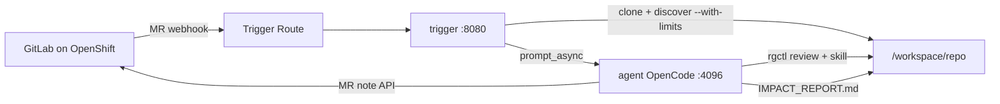

# pr-reviewer-agent

[](https://github.com/sshaaf/pr-reviewer-agent/actions/workflows/build-agent.yml)
[](https://github.com/sshaaf/pr-reviewer-agent/actions/workflows/build-trigger.yml)
[](https://quay.io/repository/sshaaf/pr-reviewer-agent)
[](https://quay.io/repository/sshaaf/pr-reviewer-trigger)
[](deploy/openshift/README.md)

OpenCode + [`rgctl`](https://github.com/sshaaf/rgctl) agent that reviews GitLab merge requests with call-graph impact analysis. Built for **OpenShift** with an **in-cluster GitLab**.

## What the agent does

- Receives GitLab MR webhooks (open / update) via a thin trigger sidecar
- Clones the MR, seeds a base `rgctl` graph artifact under resource limits
- Runs `rgctl review paths` (and optional blast-radius / policy check)
- Writes a machine-usable **`IMPACT_REPORT.md`** (Mermaid overview, blast radius, communities, test handoff)
- Posts a short **four-section review** as a GitLab MR note
- Runs constrained on small pods (`RGCTL_WITH_LIMITS`, modest fanout / max-symbols)

## Flow



## Layout

```
agent/                    Agent image (OpenCode + rgctl + skill)
trigger/                  GitLab webhook trigger image
deploy/openshift/         Kustomize manifests (agent + trigger sidecar pod)
.github/workflows/        Build/push Quay images
```

## Images

| Image | Registry |
|-------|----------|
| Agent | `quay.io/sshaaf/pr-reviewer-agent` |
| Trigger | `quay.io/sshaaf/pr-reviewer-trigger` |

## Local build / smoke

```bash
docker build --platform linux/amd64 -f agent/Dockerfile -t pr-reviewer-agent:latest .
cp agent/.env.example agent/.env   # set LITELLM_API_KEY for e2e
./agent/scripts/smoke-test.sh pr-reviewer-agent:latest
./agent/scripts/e2e-review-smoke.sh pr-reviewer-agent:latest
```

## OpenShift + GitLab

See **[deploy/openshift/README.md](deploy/openshift/README.md)** for Secrets, `GITLAB_URL`, webhook registration, and verify steps.

```bash
oc apply -k deploy/openshift
```

## Skill Input JSON

Documented in [`agent/.opencode/skills/rgctl-pr-reviewer-v2/SKILL.md`](agent/.opencode/skills/rgctl-pr-reviewer-v2/SKILL.md) (includes `project_id`, `gitlab_token`, `gitlab_url` for OpenShift MR reviews).
