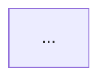

# rgctl PR Reviewer v2

Automated PR review via the **`rgctl review`** CLI (`review paths`, `review check`). No `rgctl serve`, no `--watch`, no incremental `update` daemon — only base artifact prep plus temporal review commands.

Default mode synthesizes a delta head from the base graph artifact + git name-status between `--base-ref` and `--head-ref`.

## When to Use

- The user asks you to review a Pull Request, code diff, or branch.
- The user asks for the "blast radius" or impact of changed functions.
- The user wants to verify if a PR violates architectural boundaries or coupling rules.
- Input JSON contains `repo_url`, `pr_number`, `base_ref`, `head_ref`, and `github_token` or `gitlab_token`.

## Prerequisites

- Work in `REPO_PATH` (default `/app/repo` or `.`). `cd` there before any git/rgctl command.
- Repo checked out with both `base_ref` and `head_ref` fetchable (working tree at PR head is fine).
- `base_ref` set (Input JSON; default `origin/main`). A git ref alone is **not** enough.
- A **base graph artifact** for that ref. Without it, review fails with `base graph snapshot not configured`.

Base artifact resolution order (root must contain `.rgctl/graph.snapshot.bin`):

1. `--base-artifact` / Input JSON `artifact_path` (local path after restore)
2. `$RGCTL_BASE_ARTIFACT`
3. `{repo}/.rgctl-base/`

Expected layout: `{base_root}/.rgctl/graph.snapshot.bin`  
(e.g. `.rgctl-base/.rgctl/graph.snapshot.bin`).

Do **not** start `rgctl serve` or `rgctl serve --watch` for this skill.

## Input JSON

```json
{
  "repo_url": "https://gitlab.example.com/acme/payments.git",
  "pr_number": 142,
  "project_id": 42,
  "base_ref": "origin/main",
  "head_ref": "abc123def456",
  "github_token": null,
  "gitlab_token": "glpat-...",
  "gitlab_url": "http://gitlab-webservice-default.gitlab.svc:8181",
  "policy_json": null,
  "artifact_path": null,
  "config": {
    "upstream_depth": 2,
    "downstream_depth": 1,
    "fanout": 5,
    "max_symbols": 25,
    "output_mode": "comment",
    "skip_post": false,
    "impact_report_path": "IMPACT_REPORT.md"
  }
}
```

### OpenShift + in-cluster GitLab

When invoked by the OpenShift webhook trigger (shared pod workspace):

- `REPO_PATH` / working tree is **already prepared** at the MR head (clone + `.rgctl-base` seeded). Prefer that tree; do not re-clone.
- `project_id` is the numeric GitLab project id; `pr_number` is the MR **iid**.
- `gitlab_url` is the API base (often the in-cluster Service). Use it for notes API if set; otherwise derive from `repo_url`.
- Default delivery is `config.output_mode: "comment"` → post the four-section review as an MR note; still write `IMPACT_REPORT.md` on disk.

`policy_json` is optional (skip `review check` if absent).  
`artifact_path` is optional; local base-artifact root (else `$RGCTL_BASE_ARTIFACT` or `{repo}/.rgctl-base/`).  
`base_ref` must be the MR target (e.g. `origin/main`).  
`config.output_mode`: `comment` | `check_run` | `session`.  
`config.skip_post: true` or `output_mode: "session"` → emit the four-section review into the OpenCode session only; do **not** call GitHub/GitLab APIs (smoke / local).  
`config.impact_report_path`: optional path relative to repo root (default `IMPACT_REPORT.md`). Always write this file on a successful review (all output modes).  
`config.fanout` / `config.max_symbols`: keep modest on Kubernetes agent pods (defaults above).  
Resource limits for discover: honor `$RGCTL_WITH_LIMITS` (e.g. `max-mem-mb=1536,threads=1`) and always pass `--with-limits` on `rgctl discover` so indexing stays under the pod memory/CPU budget.

## Steps

### Step 0: Resolve / create base artifact for `base_ref`

Required before any `rgctl review` command.

```bash
cd "${REPO_PATH:-.}"
BASE_REF="${base_ref:-origin/main}"
HEAD_REF="${head_ref:-HEAD}"
BASE_ROOT="${artifact_path:-${RGCTL_BASE_ARTIFACT:-.rgctl-base}}"

if [ -f "${BASE_ROOT}/.rgctl/graph.snapshot.bin" ]; then
  echo "using base artifact at ${BASE_ROOT}"
elif [ -n "${artifact_path}" ] && [[ "${artifact_path}" == s3://* ]]; then
  # restore object-storage cache into a local dir, then set BASE_ROOT
  :
else
  # Create base artifact: discover at base_ref, copy into .rgctl-base/
  # Always constrain discover for container/K8s budgets (env or explicit flag).
  LIMITS_SPEC="${RGCTL_WITH_LIMITS:-max-mem-mb=1536,threads=1}"
  git fetch origin "$(echo "$BASE_REF" | sed 's#^origin/##')" 2>/dev/null || true
  git worktree add --detach /tmp/rgctl-base-wt "$BASE_REF"
  (
    cd /tmp/rgctl-base-wt
    rgctl discover . --with-cfg --with-limits "${LIMITS_SPEC}"
  )
  mkdir -p .rgctl-base
  rm -rf .rgctl-base/.rgctl
  cp -a /tmp/rgctl-base-wt/.rgctl .rgctl-base/
  git worktree remove --force /tmp/rgctl-base-wt
  BASE_ROOT=".rgctl-base"
fi

test -f "${BASE_ROOT}/.rgctl/graph.snapshot.bin" \
  || { echo "ERROR: base graph artifact missing for ${BASE_REF}; cannot run PR review"; exit 1; }

export RGCTL_BASE_ARTIFACT="$(cd "${BASE_ROOT}" && pwd)"
```

Notes:
- Seed with `mkdir -p .rgctl-base && cp -a .rgctl .rgctl-base/` after discovering **at `base_ref`** → `.rgctl-base/.rgctl/…`.
- Do **not** copy the PR-branch `.rgctl/` into `.rgctl-base/`.
- No second full `discover` on the PR head is required; `review` synthesizes the delta head by default.

### Step 1: Call-path delta (`rgctl review paths`)

Keep intermediate JSON **inside the repo** (not `/tmp`) so OpenCode does not block on `external_directory`:

```bash
mkdir -p "${REPO_PATH:-.}/.rgctl"
rgctl -f json review paths \
  --base-artifact "${RGCTL_BASE_ARTIFACT}" \
  --base-ref "${BASE_REF}" \
  --head-ref "${HEAD_REF}" \
  --upstream-depth <upstream_depth> \
  --downstream-depth <downstream_depth> \
  --fanout <fanout> \
  --max-symbols <max_symbols> \
  > "${REPO_PATH:-.}/.rgctl/review-paths.json"
```

Defaults suitable for small agent pods: `upstream_depth=2`, `downstream_depth=1`, `fanout=5`, `max_symbols=25`.

Parse JSON (`schema_version: 1`). Extract:
- `path_delta` kinds: `added` / `removed` / `retargeted`
- Top-N impacted symbols by delta size
- `change_summary` and truncation flags

Exit code **2** → ambiguous candidates; narrow with `--symbol <name>`.

### Step 2: Blast radius (optional, top-N symbols)

After Step 1, the synthesized head snapshot is available under `{repo}/.rgctl/`. For top-N impacted symbols:

```bash
rgctl -f json blast-radius --classify-boundary <symbol>
```

If no `policy_json`, pass `--no-policy` to avoid a missing default policy file error.

Note boundary kinds, hop distances, and deprecated endpoints in the impact zone.

### Step 3: Policy gate (`rgctl review check`, if `policy_json` provided)

```bash
# Write policy_json to ${REPO_PATH}/.rgctl/policy.json when provided (avoid /tmp).
rgctl -f json review check \
  --policy-file "${REPO_PATH:-.}/.rgctl/policy.json" \
  --bisect \
  --base-artifact "${RGCTL_BASE_ARTIFACT}" \
  --base-ref "${BASE_REF}" \
  --head-ref "${HEAD_REF}" \
  > "${REPO_PATH:-.}/.rgctl/review-check.json"
```

Parse violations (`new` / `existing` / `resolved` / `regression`). `--bisect` attributes each to the introducing commit. Skip this step when `policy_json` is absent.

### Step 4: Write Impact Report, then synthesize short review

Do **both** on every successful run (session, comment, and check_run):

1. Write the durable **Impact Report** file (primary agent handoff).
2. Emit the **four-section** human summary (session reply and/or VCS post).

#### 4a. Impact Report file

Path: `config.impact_report_path` if set, else `{REPO_PATH}/IMPACT_REPORT.md`.

Write markdown with this exact structure (H2 order fixed):

~~~~
# Impact Report

## Overview
(1–3 sentences + symbol/path counts from review paths)

## Impact Diagram



## Change Set
(Index of files / top symbols in scope)

## Changes
(One ### subsection per Change Set item)

## Blast Radius
(Upstream / downstream from review paths + optional blast-radius)

## Communities
(Communities/modules touched; boundary crossings when classified)

## Policy Findings
(new/existing/resolved/regression — or "No policy configured")

## Test Handoff
(Bullets: suggested tests, untested dependents, symbol/path ids for a test agent)

## Sources
(base_ref, head_ref, base artifact path, commands used)
~~~~

**Mermaid rules (Impact Diagram):**

- Exactly one fenced mermaid code block under `## Impact Diagram` (language tag `mermaid`).
- Prefer `flowchart LR`.
- Nodes and edges MUST come from Step 1–2 JSON (`path_delta`, symbols, blast-radius / boundary labels). Do **not** invent symbols or edges.
- Cap ~25 nodes; truncate labels; summarize remainder as `N more…`.
- If there is no material path delta: still emit a minimal diagram (e.g. `base` → `head` with label `no path delta`).

**Section content rules:**

- **Change Set** — list every file or top-level symbol in scope (respect `--max-symbols` / fanout; note truncated remainder).
- **Changes** — one `###` heading per Change Set item: delta kinds (added/removed/retargeted), blast notes, risk.
- **Blast Radius** — upstream/downstream hops; boundary kinds when Step 2 ran.
- **Communities** — communities/modules touched; call out crossings / deprecated boundaries when present.
- **Policy Findings** — from Step 3, or state that no policy is configured.
- **Test Handoff** — concrete bullets (not essays): cases to add, untested dependents, symbol/path identifiers for a follow-up test agent.
- **Sources** — `base_ref`, `head_ref`, resolved `RGCTL_BASE_ARTIFACT` path, and the rgctl commands run.

#### 4b. Four-section structured review (human / session / PR)

Produce a Markdown review with these exact section headings:

1. **High-level Summary** — What changed, symbol count, overall risk. MAY mention the Impact Report path.
2. **Call-Path & Architecture Impact** — Steps 1–2: added/removed/retargeted paths; boundary crossings; deprecated boundaries.
3. **Test Coverage & Regressions** — Downstream deps in the blast radius lacking tests; suggest cases targeting `path_delta`.
4. **Line-by-Line Feedback** — Logic, bugs, style from the git diff (`git diff ${BASE_REF}...${HEAD_REF}`).

Do **not** paste the full Impact Report into the PR comment. The report file is the deep handoff; this summary stays short.

**Output routing (four-section review):**

- If `config.output_mode` is `session` **or** `config.skip_post` is true: write the four-section Markdown as the assistant reply in the current OpenCode session and **stop** (no VCS API calls). Prefer this for smoke tests. The Impact Report file MUST already be on disk.
- If `output_mode` is `comment` (default): POST the four-section summary via GitHub/GitLab API using `github_token` / `gitlab_token` (Impact Report file still written):
  - GitHub: `POST /repos/{owner}/{repo}/issues/{pr_number}/comments`
  - GitLab: `POST {gitlab_url}/api/v4/projects/{project_id}/merge_requests/{pr_number}/notes`
    - Prefer numeric `project_id` from Input JSON. If absent, URL-encode the path from `repo_url` (`namespace%2Fproject`).
    - Body JSON: `{ "body": "<four-section markdown>" }`
    - Header: `PRIVATE-TOKEN: <gitlab_token>` (or `Authorization: Bearer <gitlab_token>`)
- If `output_mode` is `check_run`: GitHub Check run / GitLab pipeline note (Impact Report file still written).

Auth when posting GitHub: `Authorization: Bearer <token>` or `Authorization: token <token>`.

## Gotchas

- **Base artifact is mandatory.** `--base-ref origin/main` alone does not load a graph. Run Step 0 first.
- Layout: `{base_root}/.rgctl/graph.snapshot.bin`. Correct: `cp -a .rgctl .rgctl-base/`. Wrong: `cp -a .rgctl/* .rgctl-base/` (flattens away `.rgctl/`).
- **No serve/watch/update.** Do not run `rgctl serve`, `rgctl serve --watch`, or `rgctl update` for this workflow.
- `review paths` → `schema_version: 1` (int). `review check` → `schema_version: "2"` (string).
- Exit code 2 on `review paths` → disambiguate with `--symbol`.
- Defaults (agent/K8s): `--upstream-depth 2`, `--downstream-depth 1`, `--fanout 5`, `--max-symbols 25`. Raise only when the pod has more CPU/memory.
- Use `--full-snapshots` only when both base and head artifacts are pre-built; otherwise keep default delta-head synthesis.
- Always write `IMPACT_REPORT.md` (or `config.impact_report_path`) before finishing — even in `session` / `skip_post` mode. Do not substitute the report for the four-section headings.
- Prefer paths under `REPO_PATH` for scratch JSON and the Impact Report. Avoid `/tmp` unless `external_directory` for `/tmp` is allowed.
- **Resource limits:** Agent pods typically have ~2Gi / 2 CPU. Always run `rgctl discover … --with-limits` (or set `RGCTL_WITH_LIMITS=max-mem-mb=1536,threads=1`). Soft RSS tripwire aborts near ~95% of `max-mem-mb` instead of OOM-killing the pod. If discover aborts on memory, lower threads, drop languages with `-l`, or raise the pod limit + `max-mem-mb` together — leave headroom for OpenCode.
