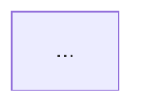

# rgctl PR Reviewer v2

Automated PR review via the **`rgctl review`** CLI (`review paths`, `review check`). No `rgctl serve`, no `--watch`, no incremental `update` daemon — only base artifact prep plus temporal review commands.

Default mode synthesizes a delta head from the base graph artifact + git name-status between `--base-ref` and `--head-ref`.

## When to Use

- The user asks you to review a Pull Request, code diff, or branch.
- The user asks for the "blast radius" or impact of changed functions.
- The user wants to verify if a PR violates architectural boundaries or coupling rules.
- Input JSON contains `repo_url`, `pr_number`, `base_ref`, `head_ref`, and `github_token` or `gitlab_token`.

## Prerequisites

- Work in `REPO_PATH` (default `/app/repo` or `.`). `cd` there before any git/rgctl command.
- Repo checked out with both `base_ref` and `head_ref` fetchable (working tree at PR head is fine).
- `base_ref` set (Input JSON; default `origin/main`). A git ref alone is **not** enough.
- A **base graph artifact** for that ref. Without it, review fails with `base graph snapshot not configured`.

Base artifact resolution order (root must contain `.rgctl/graph.snapshot.bin`):

1. `--base-artifact` / Input JSON `artifact_path` (local path after restore)
2. `$RGCTL_BASE_ARTIFACT`
3. `{repo}/.rgctl-base/`

Expected layout: `{base_root}/.rgctl/graph.snapshot.bin`  
(e.g. `.rgctl-base/.rgctl/graph.snapshot.bin`).

Do **not** start `rgctl serve` or `rgctl serve --watch` for this skill.

## Input JSON

```json
{
  "repo_url": "https://gitlab.example.com/acme/payments.git",
  "pr_number": 142,
  "project_id": 42,
  "base_ref": "origin/main",
  "head_ref": "abc123def456",
  "github_token": null,
  "gitlab_token": "glpat-...",
  "gitlab_url": "http://gitlab-webservice-default.gitlab.svc:8181",
  "policy_json": null,
  "artifact_path": null,
  "config": {
    "upstream_depth": 2,
    "downstream_depth": 1,
    "fanout": 5,
    "max_symbols": 25,
    "output_mode": "comment",
    "skip_post": false,
    "post_inline_comments": true,
    "impact_report_path": "IMPACT_REPORT.md"
  }
}
```

### OpenShift + in-cluster GitLab

When invoked by the OpenShift webhook trigger (shared pod workspace):

- `REPO_PATH` / working tree is **already prepared** at the MR head (clone + `.rgctl-base` seeded). Prefer that tree; do not re-clone.
- `project_id` is the numeric GitLab project id; `pr_number` is the MR **iid**.
- `gitlab_url` is the API base (often the in-cluster Service). Use it for notes API if set; otherwise derive from `repo_url`.
- Default delivery is `config.output_mode: "comment"` → post Verdict + four-section review + Guidelines as an MR note **and** post §3/§4 line findings as inline diff discussions (Changes tab); still write `IMPACT_REPORT.md` (with matching `## Verdict`) on disk.

### OpenShift + GitHub App

When invoked by the GitHub App trigger (`TRIGGER_PROVIDER=github`, webhook `/hooks/github`):

- `github_token` is a short-lived **installation access token** (not a PAT). Use it for clone-auth already done by the trigger and for posting.
- Default delivery: PR issue comment + Files-tab review comments (and optional `check_run`). **Do not** create branches, push commits, or open new PRs (read-only v1).
- See `docs/github-app.md` for App permissions and `@mention` behavior (handled by the trigger, not this skill).

`policy_json` is optional. If absent, still run `review check` when the repo has `.rgctl/policy.json` or root `policy.json` (see Step 3).  
`artifact_path` is optional; local base-artifact root (else `$RGCTL_BASE_ARTIFACT` or `{repo}/.rgctl-base/`).  
`base_ref` must be the MR target (e.g. `origin/main`).  
`config.output_mode`: `comment` | `check_run` | `session`.  
`config.skip_post: true` or `output_mode: "session"` → emit the four-section review into the OpenCode session only; do **not** call GitHub/GitLab APIs (smoke / local).  
`config.post_inline_comments`: default `true` when `output_mode` is `comment`. When true, also post §3/§4 findings as **inline diff comments** (GitLab Changes tab / GitHub Files changed). Set `false` to skip.  
`config.impact_report_path`: optional path relative to repo root (default `IMPACT_REPORT.md`). Always write this file on a successful review (all output modes).  
`config.fanout` / `config.max_symbols`: keep modest on Kubernetes agent pods (defaults above).  
Resource limits for discover (mandatory on every `rgctl discover`):
- Export/honor `$RGCTL_WITH_LIMITS` (default `max-mem-mb=1536,threads=1`).
- Keys: `max-mem-mb` (aliases `max-mem`, `memory-mb`) soft RSS budget — warn ~90%, abort ~95%; `threads` (aliases `thread`, `max-thread`, `max-threads`) caps discover/CFG Rayon workers.
- Always pass `--with-limits "$RGCTL_WITH_LIMITS"` on `rgctl discover` (the container wrapper injects this if omitted). Never run unbounded discover in the pod.

## Steps

### Step 0: Resolve / create base artifact for `base_ref`

Required before any `rgctl review` command.

```bash
cd "${REPO_PATH:-.}"
BASE_REF="${base_ref:-origin/main}"
HEAD_REF="${head_ref:-HEAD}"
BASE_ROOT="${artifact_path:-${RGCTL_BASE_ARTIFACT:-.rgctl-base}}"

if [ -f "${BASE_ROOT}/.rgctl/graph.snapshot.bin" ]; then
  echo "using base artifact at ${BASE_ROOT}"
elif [ -n "${artifact_path}" ] && [[ "${artifact_path}" == s3://* ]]; then
  # restore object-storage cache into a local dir, then set BASE_ROOT
  :
else
  # Create base artifact: discover at base_ref, copy into .rgctl-base/
  # Always constrain discover for container/K8s budgets (env or explicit flag).
  LIMITS_SPEC="${RGCTL_WITH_LIMITS:-max-mem-mb=1536,threads=1}"
  git fetch origin "$(echo "$BASE_REF" | sed 's#^origin/##')" 2>/dev/null || true
  git worktree add --detach /tmp/rgctl-base-wt "$BASE_REF"
  (
    cd /tmp/rgctl-base-wt
    rgctl discover . --with-cfg --with-limits "${LIMITS_SPEC}"
  )
  mkdir -p .rgctl-base
  rm -rf .rgctl-base/.rgctl
  cp -a /tmp/rgctl-base-wt/.rgctl .rgctl-base/
  git worktree remove --force /tmp/rgctl-base-wt
  BASE_ROOT=".rgctl-base"
fi

test -f "${BASE_ROOT}/.rgctl/graph.snapshot.bin" \
  || { echo "ERROR: base graph artifact missing for ${BASE_REF}; cannot run PR review"; exit 1; }

export RGCTL_BASE_ARTIFACT="$(cd "${BASE_ROOT}" && pwd)"
```

Notes:
- Seed with `mkdir -p .rgctl-base && cp -a .rgctl .rgctl-base/` after discovering **at `base_ref`** → `.rgctl-base/.rgctl/…`.
- Do **not** copy the PR-branch `.rgctl/` into `.rgctl-base/`.
- No second full `discover` on the PR head is required; `review` synthesizes the delta head by default.

### Step 1: Call-path delta (`rgctl review paths`)

Keep intermediate JSON **inside the repo** (not `/tmp`) so OpenCode does not block on `external_directory`:

```bash
mkdir -p "${REPO_PATH:-.}/.rgctl"
rgctl -f json review paths \
  --base-artifact "${RGCTL_BASE_ARTIFACT}" \
  --base-ref "${BASE_REF}" \
  --head-ref "${HEAD_REF}" \
  --upstream-depth <upstream_depth> \
  --downstream-depth <downstream_depth> \
  --fanout <fanout> \
  --max-symbols <max_symbols> \
  > "${REPO_PATH:-.}/.rgctl/review-paths.json"
```

Defaults suitable for small agent pods: `upstream_depth=2`, `downstream_depth=1`, `fanout=5`, `max_symbols=25`.

Parse JSON (`schema_version: 1`). Extract:
- `path_delta` kinds: `added` / `removed` / `retargeted`
- Top-N impacted symbols by delta size
- `change_summary` and truncation flags

Exit code **2** → ambiguous candidates; narrow with `--symbol <name>`.

### Step 2: Blast radius (optional, top-N symbols)

After Step 1, the synthesized head snapshot is available under `{repo}/.rgctl/`. For top-N impacted symbols:

```bash
rgctl -f json blast-radius --classify-boundary <symbol>
```

If no active policy file will be used in Step 3, pass `--no-policy` to avoid a missing default policy file error.

Note boundary kinds, hop distances, and deprecated endpoints in the impact zone.

### Step 3: Policy gate (`rgctl review check`, if active policy available)

Resolve active policy in this order (first win):

1. Input `policy_json` when non-null — materialize to `${REPO_PATH}/.rgctl/policy.json`
2. Else `${REPO_PATH}/.rgctl/policy.json` if present
3. Else `${REPO_PATH}/policy.json` — copy to `${REPO_PATH}/.rgctl/policy.json`

Helper (optional): `bash /app/scripts/resolve-policy.sh "${REPO_PATH}"` exits 0 and prints the materialized path when a repo file exists.

```bash
mkdir -p "${REPO_PATH:-.}/.rgctl"
# If Input policy_json is a JSON string or object, write it to .rgctl/policy.json first.
# Else: cp policy.json → .rgctl/policy.json when only the repo root file exists.
POLICY_FILE="${REPO_PATH:-.}/.rgctl/policy.json"
if [ ! -f "${POLICY_FILE}" ] && [ -f "${REPO_PATH:-.}/policy.json" ]; then
  cp -f "${REPO_PATH:-.}/policy.json" "${POLICY_FILE}"
fi

if [ -f "${POLICY_FILE}" ]; then
  rgctl -f json review check \
    --policy-file "${POLICY_FILE}" \
    --bisect \
    --base-artifact "${RGCTL_BASE_ARTIFACT}" \
    --base-ref "${BASE_REF}" \
    --head-ref "${HEAD_REF}" \
    > "${REPO_PATH:-.}/.rgctl/review-check.json"
else
  echo "No policy configured" > "${REPO_PATH:-.}/.rgctl/review-check.json"
fi
```

Parse violations (`new` / `existing` / `resolved` / `regression`). `--bisect` attributes each to the introducing commit. Skip `review check` only when **no** active policy file exists after resolution. Policy **new** / **regression** feed Verdict **RED** (existing ladder).

### Step 3b: Review guidance docs (soft)

After Step 1 path delta is known, look for repo guidance that may apply to the MR. This step is **advisory** — it MUST NOT alone set Verdict to RED.

**Candidate paths** (repo-relative; check in this order, case-sensitive then case-insensitive):

- `REVIEW.md`, `docs/REVIEW.md`
- `AGENTS.md`, `docs/AGENTS.md`

**Do not** treat `Architecture.md` / `docs/architecture.md` / ADR trees as review inputs unless those files are also named `REVIEW.md` or `AGENTS.md`.

**Exclude:** `rgctl-benchmark/**`, `.claude/**`, `target/**`, `node_modules/**`, vendored trees.

**Cap:** read at most these **4** candidates (skip quietly when absent). Prefer root over `docs/` when both exist for the same name.

For each file found, extract constraints / review hints that relate to modules/symbols in `path_delta` or review-paths output. Surface matches in §2 Call-Path & Architecture Impact and/or Guidelines **Concerns** / **Open questions**, citing the doc path. Prefer “doc says X; graph/diff shows Y” — do not invent blast edges from prose alone.

### Step 4: Write Impact Report, then synthesize short review

Do **both** on every successful run (session, comment, and check_run):

1. Write the durable **Impact Report** file (primary agent handoff).
2. Emit the **four-section** human summary (session reply and/or VCS post).

#### 4a. Impact Report file

Path: `config.impact_report_path` if set, else `{REPO_PATH}/IMPACT_REPORT.md`.

Write markdown with this exact structure (H2 order fixed):

~~~~
# Impact Report

## Overview
(1–3 sentences + symbol/path counts from review paths)

## Verdict
(`🟢 GREEN` | `🟡 YELLOW` | `🔴 RED`) — one sentence why. Same COLOR as the MR note.

### Concerns
(Bullets the author should acknowledge before merge, or `None`)

## Impact Diagram



## Change Set
(Index of files / top symbols in scope)

## Changes
(One ### subsection per Change Set item)

## Blast Radius
(Upstream / downstream from review paths + optional blast-radius)

## Communities
(Communities/modules touched; boundary crossings when classified)

## Policy Findings
(new/existing/resolved/regression from Step 3 — or "No policy configured")

## Test Handoff
(Bullets: suggested tests, untested dependents, symbol/path ids for a test agent)

## Sources
(base_ref, head_ref, base artifact path, commands used; MAY list REVIEW.md / AGENTS.md paths from Step 3b)
~~~~

**Mermaid rules (Impact Diagram):**

- Exactly one fenced mermaid code block under `## Impact Diagram` (language tag `mermaid`).
- Prefer `flowchart LR`.
- Nodes and edges MUST come from Step 1–2 JSON (`path_delta`, symbols, blast-radius / boundary labels). Do **not** invent symbols or edges.
- Cap ~25 nodes; truncate labels; summarize remainder as `N more…`.
- If there is no material path delta: still emit a minimal diagram (e.g. `base` → `head` with label `no path delta`).

**Section content rules:**

- **Verdict** — same COLOR + one-sentence why as the MR note; Concerns list MUST match Guidelines.
- **Change Set** — list every file or top-level symbol in scope (respect `--max-symbols` / fanout; note truncated remainder).
- **Changes** — one `###` heading per Change Set item: delta kinds (added/removed/retargeted), blast notes, risk.
- **Blast Radius** — upstream/downstream hops; boundary kinds when Step 2 ran.
- **Communities** — communities/modules touched; call out crossings / deprecated boundaries when present.
- **Policy Findings** — from Step 3 when an active policy file was used; otherwise state that no policy is configured.
- **Test Handoff** — concrete bullets (not essays): cases to add, untested dependents, symbol/path identifiers for a follow-up test agent.
- **Sources** — `base_ref`, `head_ref`, resolved `RGCTL_BASE_ARTIFACT` path, rgctl commands run, and optional doc paths from Step 3b.

#### 4b. Verdict, four-section review, and Guidelines (human / session / PR)

**Traffic-light ladder (first match wins — pick exactly one COLOR):**

1. **RED** if any: policy **new** or **regression** from Step 3; security / auth / PII / payment integrity issue; clear functional break with no mitigation.
2. Else **YELLOW** if any: user-visible behavior change on a hot path without tests; medium+ blast radius with weak coverage; dead/misleading code that could ship by accident; product/intent ambiguity on user-visible numbers or contracts; **evidence-linked** REVIEW.md / AGENTS.md Concerns from Step 3b.
3. Else **GREEN** (nits / style / docs only, small blast, no policy new/regression).

YELLOW means “ship with eyes open”, not soft-RED. Always write the word `GREEN` / `YELLOW` / `RED` next to the emoji. **Do not** set RED solely because of Step 3b REVIEW.md / AGENTS.md findings.

Produce Markdown in this **exact order**:

```markdown
## Verdict: 🟡 YELLOW — <one sentence why>

## 1. High-level Summary
...

## 2. Call-Path & Architecture Impact
...

## 3. Test Coverage & Regressions
...

## 4. Line-by-Line Feedback
...

## Guidelines

### Concerns
(acknowledge before merge — or `None`)

### Blockers
(must fix before merge — required non-empty for RED; else `None`)

### Open questions
(or `None`)

### What’s fine
(what is safe / low risk)
```

Section content:

1. **High-level Summary** — What changed, symbol count. Do **not** invent a second risk scale; the Verdict is authoritative. MAY mention `IMPACT_REPORT.md`.
2. **Call-Path & Architecture Impact** — Steps 1–2: added/removed/retargeted paths; boundary crossings; deprecated boundaries. Include Step 3b doc citations when constraints apply to the delta.
3. **Test Coverage & Regressions** — Downstream deps in the blast radius lacking tests; suggest cases targeting `path_delta`. When a finding maps to a concrete changed line, cite `path:line` (repo-relative).
4. **Line-by-Line Feedback** — Logic, bugs, style from the git diff (`git diff ${BASE_REF}...${HEAD_REF}`). **Every bullet MUST start with** `` `path:line` `` or `` `path:start-end` `` (use the **new** file line number for added/modified lines).
5. **Guidelines** (after §4) — Concerns / Blockers / Open questions / What’s fine as above. For RED, list Blockers first with at least one item.

Do **not** paste the full Impact Report into the PR comment. The report file is the deep handoff; this summary stays short.

**Output routing (four-section review):**

- If `config.output_mode` is `session` **or** `config.skip_post` is true: write the four-section Markdown as the assistant reply in the current OpenCode session and **stop** (no VCS API calls). Prefer this for smoke tests. The Impact Report file MUST already be on disk.
- If `output_mode` is `comment` (default):
  1. POST the four-section summary as a top-level MR/PR note (Impact Report file still written):
     - GitHub: `POST /repos/{owner}/{repo}/issues/{pr_number}/comments`
     - GitLab: `POST {gitlab_url}/api/v4/projects/{project_id}/merge_requests/{pr_number}/notes`
       - Prefer numeric `project_id` from Input JSON. If absent, URL-encode the path from `repo_url` (`namespace%2Fproject`).
       - Body JSON: `{ "body": "<four-section markdown>" }`
       - Header: `PRIVATE-TOKEN: <gitlab_token>` (or `Authorization: Bearer <gitlab_token>`)
  2. **Inline diff comments (required when `post_inline_comments` is not false):** turn every §3/§4 finding that has a concrete `path` + line into Changes-tab comments:
     - Write `${REPO_PATH}/.rgctl/line-comments.json`:
       ```json
       {
         "provider": "gitlab",
         "gitlab_url": "<from Input JSON gitlab_url>",
         "gitlab_token": "<gitlab_token>",
         "project_id": <project_id>,
         "pr_number": <pr_number>,
         "repo_url": "<repo_url>",
         "items": [
           {"path":"src/main/java/.../ShippingService.java","new_line":22,"body":"Prefer `return 4.49;` over `(2.99 + 1.50)`.","section":"4","severity":"yellow"},
           {"path":"src/main/java/.../ShoppingCartService.java","new_line":74,"body":"Add a test for insurance guard vs new shipping band.","section":"3","severity":"yellow"}
         ]
       }
       ```
     - Optional `severity`: `green` | `yellow` | `red` — the poster prefixes `🟢` / `🟡` / `🔴` on the Changes-tab note.
     - Use `new_line` for added/modified lines (Changes tab green/right side). Use `old_line` only for pure deletions (omit `new_line`).
     - Only lines that appear in the MR diff can be commented (unchanged context lines return HTTP 400).
     - Cap ~20 items (prefer §4; include §3 only when tied to a specific changed line). Skip vendored/generated paths.
     - Run: `bash /app/scripts/post-inline-comments.sh "${REPO_PATH}/.rgctl/line-comments.json"`  
       (or `$(dirname "$0")/post-inline-comments.sh` when the script is on PATH next to the skill helpers).
     - The script posts GitLab **discussions** with a diff `position` (visible on the Changes tab) or GitHub pull-review comments.
- If `output_mode` is `check_run`: GitHub Check run / GitLab pipeline note (Impact Report file still written). Still post inline comments when `post_inline_comments` is true.

Auth when posting GitHub: `Authorization: Bearer <token>` or `Authorization: token <token>`.

## Gotchas

- **Base artifact is mandatory.** `--base-ref origin/main` alone does not load a graph. Run Step 0 first.
- Layout: `{base_root}/.rgctl/graph.snapshot.bin`. Correct: `cp -a .rgctl .rgctl-base/`. Wrong: `cp -a .rgctl/* .rgctl-base/` (flattens away `.rgctl/`).
- **No serve/watch/update.** Do not run `rgctl serve`, `rgctl serve --watch`, or `rgctl update` for this workflow.
- `review paths` → `schema_version: 1` (int). `review check` → `schema_version: "2"` (string).
- Exit code 2 on `review paths` → disambiguate with `--symbol`.
- Defaults (agent/K8s): `--upstream-depth 2`, `--downstream-depth 1`, `--fanout 5`, `--max-symbols 25`. Raise only when the pod has more CPU/memory.
- Use `--full-snapshots` only when both base and head artifacts are pre-built; otherwise keep default delta-head synthesis.
- Always write `IMPACT_REPORT.md` (or `config.impact_report_path`) before finishing — even in `session` / `skip_post` mode. Do not substitute the report for the four-section headings.
- Prefer paths under `REPO_PATH` for scratch JSON and the Impact Report. Avoid `/tmp` unless `external_directory` for `/tmp` is allowed.
- **Resource limits:** Always `rgctl discover … --with-limits "$RGCTL_WITH_LIMITS"` (`max-mem-mb` / `threads`). Soft RSS tripwire aborts near ~95% of `max-mem-mb` instead of cgroup OOM. If discover aborts, lower `threads`, filter with `-l`, or raise pod memory + `max-mem-mb` together — leave headroom for OpenCode.
